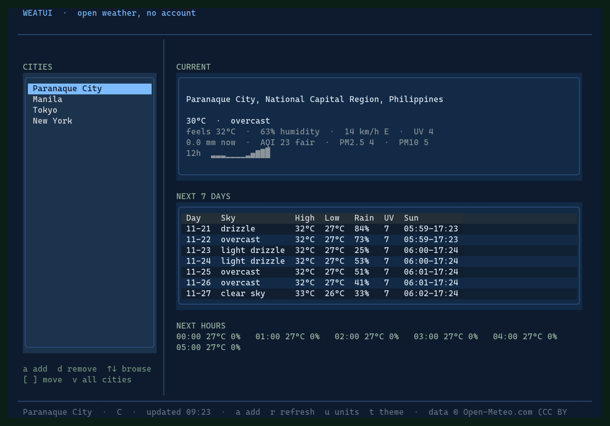

# Weatui

<p align="center"></p>

A friendly terminal weather app built with **Python + Textual** and powered by **Open-Meteo**. Save a handful of cities, switch between them, and get a clean current / 7-day / next-hours view without accounts, API keys or a browser.

<p align="center"></p>

[](https://github.com/Mark44928/Weatui/actions/workflows/ci.yml)
[](https://mark44928.github.io/Weatui/)


## Features

- saved cities in a readable JSON config, reorderable to taste
- current conditions, feels-like, humidity, wind, UV, rain and air quality
- a 12-hour temperature sparkline plus the next 7 days and next 6 hours
- city search that lets you pick the right match, not just the first one
- an all-cities compare table for a quick side-by-side
- remove-with-confirmation so a stray key does not drop a city
- Celsius / Fahrenheit toggle
- Greenit, Bluney, Yellen, Gruvbox, Catppuccin, Tokyo Night and Mono interface themes
- automatic refresh (10 minutes by default)
- city search through Open-Meteo geocoding
- no API key, no account, no telemetry
- clean fallback when the network or API is unavailable

## Install

```bash
pipx install git+https://github.com/Mark44928/Weatui.git
weatui
```

Or use the prefix-aware installer:

```bash
git clone https://github.com/Mark44928/Weatui
cd Weatui
bash install.sh
weatui
```

It creates an isolated venv and links into `$PREFIX/bin` on Termux or `~/.local/bin` on Linux. `--prefix DIR` overrides the launcher directory; `--uninstall` removes the link and managed venv.

## Keys

| Key | Action |
|---|---|
| `a` | add a city |
| `d` | remove the selected city (asks first) |
| `↑` / `↓` | choose a saved city |
| `[` / `]` | move the selected city up / down |
| `r` | refresh now |
| `u` | switch Celsius / Fahrenheit |
| `t` | cycle theme |
| `v` | compare all saved cities |
| `q` | quit |

## Config

Stored at `$XDG_CONFIG_HOME/weatui/config.json` (or `~/.config/weatui/config.json`):

```json
{
  "cities": [
    {
      "name": "Manila",
      "admin": "Metro Manila",
      "country": "Philippines",
      "latitude": 14.5995,
      "longitude": 120.9842
    }
  ],
  "units": "C",
  "theme": "greenit",
  "refresh_seconds": 600,
  "selected": 0
}
```

## CLI

```bash
weatui                      # open the TUI
weatui --list-cities        # print the saved city list
weatui --units F            # set Fahrenheit
weatui --theme yellen       # set a theme
weatui --version
```

## Development

```bash
make check
```

Runs Ruff, 13 tests and a CLI smoke check. The tests mock all Open-Meteo traffic.

## Data

Weather and geocoding data by [Open-Meteo](https://open-meteo.com/) under
[CC BY 4.0](https://creativecommons.org/licenses/by/4.0/). Weatui is not
affiliated with Open-Meteo. The app is intended for non-commercial use, matching
Open-Meteo's free API terms.

Part of the [Mark44928 family](https://mark44928.github.io/Mark44928/): [Fluffless Prompt](https://github.com/Mark44928/FlufflessPrompt) · [Greenit](https://github.com/Mark44928/Greenit) · [Bluney](https://github.com/Mark44928/Bluney) · [Yellen](https://github.com/Mark44928/Yellen).

MIT.
